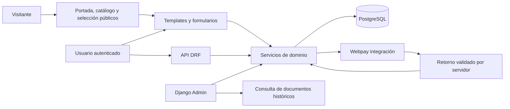

# Arquitectura BuildCorp: modelo 4+1

## Vista lógica
`accounts` representa usuarios y permisos; `inventory` activos, contratistas y ubicación; `rentals` préstamo, devolución, firma y morosidad; `maintenance` planes/trabajos; `payments` cargos e intentos; `web` presentación y composición.

API e interfaz llaman las mismas reglas. Admin permite edición de maestros; operaciones y documentos transaccionales se gestionan desde formularios/servicios, con consulta administrativa de solo lectura.

## Vista de desarrollo
Monolito organizado por dominio; cada app contiene modelos, servicios, vistas, serializers y migraciones. `web/forms.py` define formularios; templates comparten navegación, mensajes y estilos. `tests` usa Django TestCase y TransactionTestCase. Dependencias fijadas en requirements.txt y requirements-lock.txt; no se requiere Node para ejecutar la aplicación.

## Vista de procesos
Entrega: validar rol/firma → bloquear contratista → validar morosidad → bloquear activos por ID ordenado → validar disponibilidad/mantenimiento → crear préstamo, líneas, firma e historial → confirmar transacción.

Devolución: bloquear contratista/préstamo y activos → validar líneas, horas y firma → registrar devolución una sola vez → actualizar horas/estado → al cerrar, calcular cargo y resolver alertas. Errores revierten toda la operación.

Mantenimiento: fecha u horas alcanzadas impiden préstamo aun sin cron. El comando periódico registra alertas de morosidad y reporta revisiones pendientes. Los activos prestados que vencen se muestran para revisión, sin romper el préstamo vigente.

Pago: reservar intento único por cargo → solicitar token fuera de la transacción DB → redirigir al proveedor → consultar/confirmar desde servidor → validar monto/orden/sesión/respuesta → marcar cargo pagado una sola vez. Un timeout conserva UNKNOWN; un retorno repetido es idempotente. La respuesta del navegador no decide el pago.

## Vista física
Local: navegador → Django/WhiteNoise en 127.0.0.1:8013 → PostgreSQL de BuildCorp en 127.0.0.1:55433. Internet solo para pruebas Webpay y descargas de dependencias.

EC2 prevista: navegador → Nginx 80/443 → Gunicorn 127.0.0.1:8000 → Django → PostgreSQL 127.0.0.1:5432, todos en una sola instancia. Cron ejecuta revisar_alertas. Webpay permanece en integración incluso si la aplicación se publica.

## +1: escenarios que conectan las vistas

| Escenario | Componentes | Evidencia |
|---|---|---|
| Dos contratistas solicitan el mismo activo | rentals, inventory, PostgreSQL | test_one_asset_cannot_be_issued_twice_concurrently |
| Devolución parcial con daño | rentals, maintenance, firma | test_partial_return_and_repeated_return + recorrido navegador |
| Revisión por fecha u horas | maintenance, rentals | test_due_date_blocks_issue / test_due_hours_blocks_issue |
| Vencimiento sin cron | rentals, Contractor | test_overdue_blocks_without_job |
| Pago con retorno repetido | payments, gateway | test_approved_and_duplicate_return |
| Contratista consulta firma ajena | accounts, rentals, web | test_private_signature |

## Contrato HTTP
Sesión de Django y CSRF para escrituras. Listados API paginados (20 registros). Las vistas públicas permiten visitantes sin sesión. Al enviar una solicitud o acceder a documentos privados, un anónimo recibe redirección al ingreso en web y 403 en API con autenticación de sesión. Usuario sin permiso: 403; objeto de otro contratista: 404; validación: 400; conflicto de integridad: 409. Retorno externo Webpay es la única excepción CSRF de negocio; confirma mediante proveedor.

| Recurso /api/ | Operaciones |
|---|---|
| contractors, sites, warehouses, categories, assets | GET/POST/PATCH/PUT/DELETE con permisos; historial protegido |
| assets/{id}/transfer/ y retire/ | POST con motivo y destino cuando corresponde |
| loans/ | GET y POST de entrega firmada |
| loans/{id}/ | GET con alcance por contratista |
| loans/{id}/return/ | POST de devolución firmada |
| maintenance-plans/ | GET/POST/PUT/PATCH; no borrar planes que forman parte del control preventivo |
| maintenance-jobs/ | GET/POST; finish/ para cierre con próximos límites |
| charges/ | GET; pay/ y reconcile/ mediante POST |
| rental-requests/ | GET/POST privados; cancel/, reject/, delivery-quote/ y fulfill/ según rol |

El administrador gestiona contratistas; bodeguero opera inventario. Contratistas consultan únicamente préstamos/cargos propios. Campos de estado, horas, tarifas históricas, firmas y resultados bancarios no admiten edición arbitraria. Bajas/desactivaciones preservan trazabilidad cuando DELETE resulta incompatible con relaciones.

No hay entrega sustituta durante revisión, facturación tributaria, multas, reembolsos bancarios ni firma electrónica avanzada en este alcance. La firma dibujada es una constancia académica con hash y registro del usuario que la capturó.

## Extensión: tienda y solicitudes

`web/storefront.py` presenta portada, catálogo, fichas y selección pública. `accounts/services.py` registra clientes con contraseña validada, correo único sin distinguir mayúsculas y RUT normalizado con dígito verificador. El rol CONTRATISTA y la entidad propietaria se asignan en servidor; no se toman del formulario. No se vincula una cuenta nueva a un contratista existente solo por conocer su RUT.

`rentals/request_models.py` conserva la solicitud y sus líneas. `request_services.py` aplica titularidad, estados, idempotencia, morosidad y disponibilidad. La selección de sesión admite hasta veinte activos y no bloquea stock. Al enviar, las fechas se calculan como duración real en UTC y se registra una estimación; no se crea Loan ni Charge.

Bodega selecciona la obra operativa, revisa la tarifa actual y firma la entrega completa. Un resumen firmado de tarifas detecta cambios posteriores a mostrar el formulario. La transacción bloquea contratista → solicitud → activos y reutiliza `issue_loan`; solo entonces los activos pasan a uso. La devolución y Webpay siguen los servicios existentes. Una solicitud puede cancelarse por su titular o rechazarse con motivo por el personal mientras está pendiente.

Escenario +1: visitante explora `/catalogo/` → agrega equipo a `/mi-solicitud/` → se registra conservando selección → envía → bodega confirma en `/solicitudes/` → cliente consulta su préstamo → devolución genera cargo. Las pruebas de solicitud y el recorrido con navegador verifican estas conexiones.

Las imágenes públicas se entregan por `/catalogo/herramientas/<id>/imagen/`, validando que el activo siga publicado. Se usa la foto cargada o un PNG local de referencia. No se publica un directorio general de firmas. `handler404` ofrece regreso al inicio y distingue las rutas API para mantener JSON.

## Revisión de pago previo (sustituye el flujo de cobro de la tienda anterior)

Las descripciones anteriores de cobro al devolver se conservan como contexto del préstamo histórico. El flujo vigente para nuevas entregas es: solicitud sin reserva → aprobación y retención → pago inicial verificado → entrega firmada → liquidación del tiempo adicional.

`rentals/approval_services.py` fija la cotización, retiene unidades físicas mediante AssetHold y coordina cancelaciones. `payments/services.py` permite pagar un Charge INITIAL ligado a RentalRequest antes de existir Loan. Los bloqueos siguen Contractor → Request → Charge → Attempt; los activos se bloquean en orden de ID al aprobar/entregar/liberar. Las llamadas bancarias permanecen fuera de la transacción. Solo un resultado autorizado con identidad y monto válidos cambia la solicitud a PAGADA.

La entrega compartida comprueba pago, retenciones, período aprobado, mantenimiento, morosidad y firma. Ni administrador ni API pueden habilitar una entrega mediante un campo paid_at. El antiguo POST /api/loans/ exige ahora request_id, responsible y signature; rechaza el payload antiguo. GET /rentals/new/ conduce al formulario de preparación. Aprobar usa POST /api/rental-requests/{id}/approve/ con site_id y quote de GET approval-quote/. El resumen delivery-quote/ anterior se sustituye por approval-quote/. Las nuevas rutas web son /solicitudes/nueva/ y /solicitudes/{id}/aprobar/.

`payments/billing.py` conserva el cargo completo de LEGACY_POSTPAID y para PREPAID genera solo EXTRA por retraso de cada línea, al cerrar. Un saldo cero no crea cargo ni transacción bancaria. La retención no vence automáticamente: una solicitud sin pago puede cancelarse/rechazarse si no tiene un intento activo/incierto; una pagada requiere revisión y no finge un reintegro. Cambios de mantenimiento o bloqueo sobrevenidos impiden entregar aunque el pago exista.
