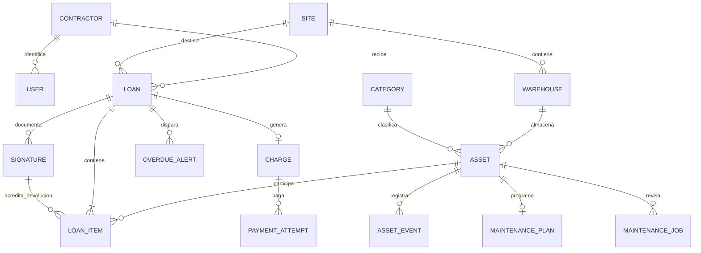

# Modelo relacional

Todas las entidades tienen PK propia. Relaciones históricas usan PROTECT. La identificación de contratista y código de activo son únicos. Usuario distingue el rol de negocio de los permisos Django.

Las líneas guardan la tarifa pactada: es un dato histórico del alquiler, no un duplicado editable de la tarifa actual. Las horas del activo son el total acumulado, actualizado atómicamente al devolver; la línea conserva el uso de cada préstamo. La suma solo cambia una vez por devolución válida.

Restricciones PostgreSQL: un préstamo abierto por herramienta (índice único parcial); una línea por activo/préstamo; un mantenimiento abierto por activo; una alerta abierta por préstamo; un intento activo por cargo; un cargo por préstamo; límites no negativos y tarifa/cargo positivos; plan con al menos un umbral; vencimiento posterior a entrega. Migraciones crean estas restricciones en la base, no solo en formularios.

Estado de préstamo cerrado: closed_at informado tras devolución completa. Morosidad se calcula a partir de vencimiento y pendientes; no depende de una bandera que cron pudiera olvidar. Bloqueo manual de contratista es independiente. Los borrados de maestros usados se rechazan y se conserva la baja lógica.

Firmas se almacenan como bytes PNG privados, con SHA-256, nombre del responsable, tipo, momento y actor. El endpoint de imagen verifica titularidad. No se guardan tarjetas, CVV ni claves del banco. El token de intento Webpay se guarda privado y no se incluye en serializers o Admin.
