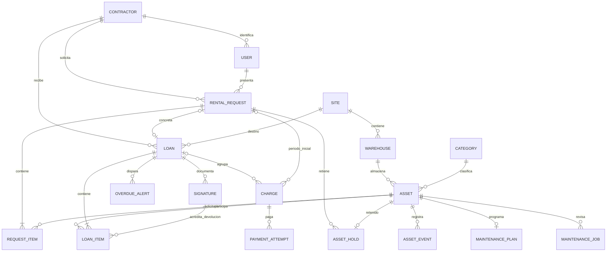

# Modelo relacional

Todas las entidades tienen PK propia. Relaciones históricas usan PROTECT. La identificación de contratista y código de activo son únicos. Usuario distingue el rol de negocio de los permisos Django.

Las líneas guardan la tarifa pactada: es un dato histórico del alquiler, no un duplicado editable de la tarifa actual. Las horas del activo son el total acumulado, actualizado atómicamente al devolver; la línea conserva el uso de cada préstamo. La suma solo cambia una vez por devolución válida.

Restricciones PostgreSQL: un préstamo abierto por herramienta (índice único parcial); una línea por activo/préstamo; un mantenimiento abierto por activo; una alerta abierta por préstamo; un intento activo por cargo; un cargo por préstamo; límites no negativos y tarifa/cargo positivos; plan con al menos un umbral; vencimiento posterior a entrega. Migraciones crean estas restricciones en la base, no solo en formularios.

Estado de préstamo cerrado: closed_at informado tras devolución completa. Morosidad se calcula a partir de vencimiento y pendientes; no depende de una bandera que cron pudiera olvidar. Bloqueo manual de contratista es independiente. Los borrados de maestros usados se rechazan y se conserva la baja lógica.

Firmas se almacenan como bytes PNG privados, con SHA-256, nombre del responsable, tipo, momento y actor. El endpoint de imagen verifica titularidad. No se guardan tarjetas, CVV ni claves del banco. El token de intento Webpay se guarda privado y no se incluye en serializers o Admin.

## Identidad y solicitud pública

El correo no vacío de User es único por `Lower(email)`. La identidad de Contractor es única después de quitar espacios, puntos y guion y convertir a mayúsculas. Las migraciones primero detectan duplicados y se detienen con sus identificadores; no eliminan usuarios ni fusionan empresas automáticamente. El registro valida el dígito verificador del RUT y crea una identidad propia.

RentalRequest guarda solicitante, contratista, obra/dirección declaradas, responsable, período previsto, notas, estimación, clave UUID de envío, huella de contenido y resolución. RequestItem conserva activo y tarifa diaria estimada; no admite dos líneas para el mismo activo/solicitud. Loan es opcional y único por solicitud entregada. La obra declarada no permite al cliente editar los Site internos.

La clave de envío y su huella permiten devolver la misma solicitud ante un doble envío idéntico y rechazar su reutilización con contenido distinto. Los estados pendientes/entregados/rechazados/cancelados preservan la trazabilidad. La tarifa estimada de RequestItem no reemplaza la tarifa histórica aceptada de LoanItem.

Asset incorpora una imagen opcional. Se valida JPEG/PNG/WebP, contenido, dimensiones máximas 4096×4096 y hasta 512 KiB para cargas del usuario. Los PNG de referencia incluidos en estáticos no son cargas del formulario y conservan sus archivos originales.

## Revisión de prepago y compatibilidad

Charge.loan pasa a FK opcional con colección Loan.charges. Charge.kind distingue LEGACY (histórico), INITIAL (período contratado ligado a RentalRequest) y EXTRA (retraso de Loan). Las restricciones exigen origen válido y un único cargo de cada propósito por su origen. voided_at impide pagar un cargo cancelado; un cargo pagado no puede quedar anulado. Un cargo inicial se enlaza al préstamo cuando se entrega, conservando su pago e ID.

RentalRequest añade APROBADA/PAGADA y guarda approved_at/by/site/amount; sus líneas conservan estimated_daily_rate y approved_daily_rate separadas. AssetHold tiene Asset único y una solicitud propietaria; se consume al entregar o libera al resolver sin pago ni intentos inciertos. La retención se audita por eventos y no sustituye los cuatro estados físicos del catálogo.

Loan.billing_mode distingue PREPAID y LEGACY_POSTPAID. La migración asigna legacy a las filas anteriores y deja prepaid como valor por defecto de nuevas filas; no altera contraseñas, pagos o documentos firmados. Los préstamos históricos conservan el cálculo anterior aunque sigan abiertos durante la actualización.
